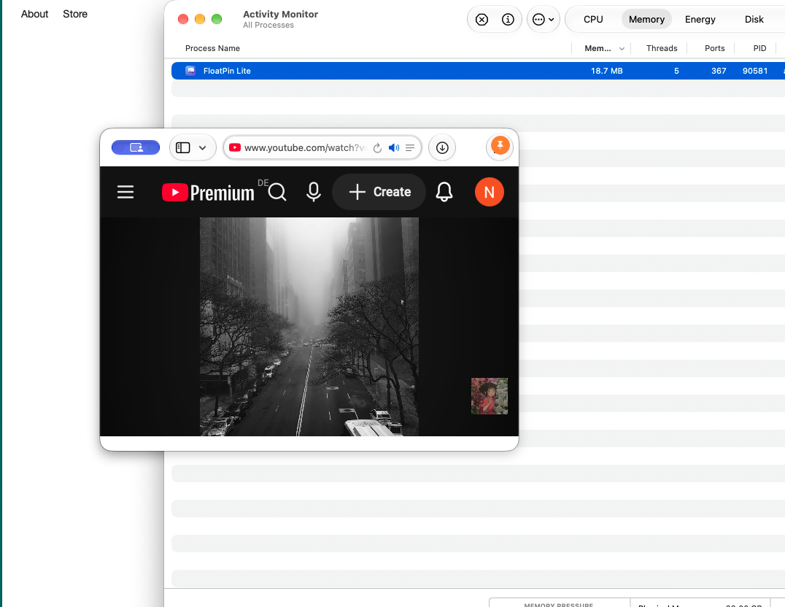

# FloatPin Lite

The leaner version of [FloatPin](https://github.com/Tron16/FloatPin). Shake a window to keep it on top. macOS 14+ menu bar app, no dependencies, no network.

This is a fork of Tron16/FloatPin (MIT). Same idea and same behavior, with the extras removed so it is smaller, lighter and builds with just the command line tools.



A YouTube window pinned on top of Activity Monitor, which lists FloatPin Lite at 18.7 MB.

## Run it

```bash
git clone https://github.com/abhinxx/FloatPinLite && cd FloatPinLite && ./build.sh install
```

Builds, installs to `/Applications` and launches. Needs only the Xcode command line tools (`xcode-select --install`), not full Xcode. `./build.sh` alone builds into `./build`.

## Use

- Drag a window by its title bar and shake it: it floats above everything until you shake it again.
- ⌃⌥P pins or unpins the front window. The menu bar lists all windows too.
- Click a pin to jump into the real window. Drag or resize a pin and the real window follows.

## Lite vs upstream

| | Upstream 1.0 | Lite 1.1 |
|---|---|---|
| Swift source | 1,375 lines, 54 KB | 1,295 lines, 51 KB |
| Files in repo | 29 | 17 |
| Repo, tracked files | 3.6 MB | 0.5 MB |
| UI framework | SwiftUI | AppKit |
| Builds with | full Xcode | command line tools |
| Binary (stripped, arm64) | not measured | 173 KB |
| Memory (Activity Monitor) | not measured | 18.7 MB with a window pinned |

Upstream could not be built here without full Xcode, so its binary size and memory are not compared. Numbers above were measured on macOS 27, Apple Silicon.

## What changed

- SwiftUI replaced by AppKit: no SwiftUI runtime in memory, and no Xcode needed to build.
- Removed sounds, pin animations, the shake-tuning sliders (fixed at 6 reversals, 2 s, 30 pt), the unused opacity setting, the DMG build, release automation, and the demo images.
- Shake detection looks up windows only when a drag starts, not on every click anywhere.
- The setup window re-checks permissions when you return from System Settings instead of polling every second.
- Capture buffer cut from 5 frames to 3.
- Frame rate choices are 15, 30 or 60 fps.
- New name and bundle ID (`com.abhinxx.FloatPinLite`), so it installs next to the original.

## How it works

macOS can't float another app's window, so FloatPin Lite streams the window (ScreenCaptureKit) into its own floating panel and keeps the real window glued underneath it (Accessibility). Only one of the two is visible at a time.

## Privacy

No network code, no analytics, nothing written to disk except its own settings. Permissions:

- **Screen Recording** to show the live copy. Frames stay in memory.
- **Accessibility** to move and raise the real window.

Builds are ad-hoc signed, so macOS forgets permissions after each rebuild. Reset with
`tccutil reset Accessibility com.abhinxx.FloatPinLite && tccutil reset ScreenCapture com.abhinxx.FloatPinLite`,
or sign with your own certificate: `SIGN_IDENTITY="Apple Development: ..." ./build.sh install`.

## Code

| File | Role |
|---|---|
| `Shake.swift` | Global mouse monitor, shake detection |
| `PinnedWindow.swift` | Floating panel, glue to the real window, `PinManager` |
| `WindowList.swift` | Window lookup (CoreGraphics), move/raise (Accessibility) |
| `Permissions.swift` | Permission checks and prompts |
| `Views.swift` | Setup and settings windows (AppKit) |
| `HotKey.swift` | ⌃⌥P shortcut |
| `AppDelegate.swift` | Menu bar menu and wiring |

MIT licensed. Original work by Ashish Nattami Subramanian.
